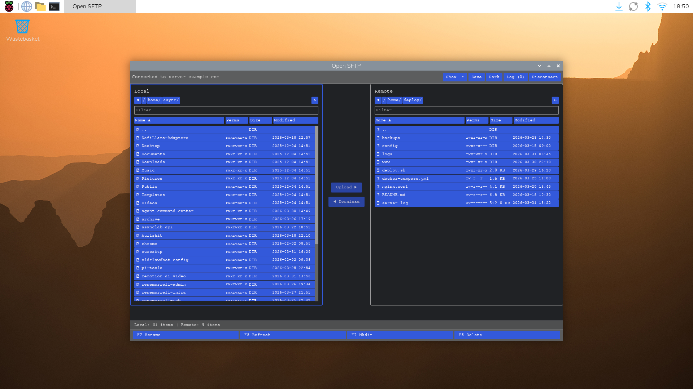
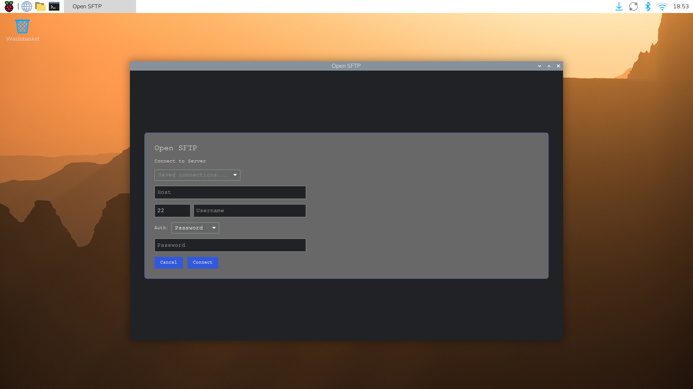

# Open SFTP

**A fast, native SFTP client written in Rust.**
Built with [Iced](https://iced.rs) for the GUI and [russh](https://github.com/warp-tech/russh) for SSH/SFTP. No Electron. No runtime overhead.

[](https://opensource.org/licenses/MIT)
[](https://www.rust-lang.org)



---

## Contents

1. [Screenshots](#screenshots)
2. [Features](#features)
3. [Quick Start](#quick-start)
4. [Build](#build)
5. [Tests](#tests)
6. [Project Structure](#project-structure)
7. [License](#license)

---

## Screenshots

| File browser (connected) | Connection dialog |
|---|---|
|  |  |

---

## Features

**Dual-pane file browser:** local filesystem on the left, remote on the right. Navigate with double-click, breadcrumb path bar, or keyboard shortcuts.

**Transfers:** upload and download files and entire directories recursively. Live progress bar with byte counters. Transfer log with success/failure status.

**Authentication:** password, SSH key file, or SSH agent. Reads known hosts from `~/.ssh/known_hosts` with host key verification.

**Connection profiles:** save, load, and manage server connections. Import existing profiles from the Python [openSFTP](https://github.com/mylilcrowdi/sftp-ui) client (`~/.config/sftp-ui/connections.json`).

**Remote operations:** create directories, rename files, delete files and folders directly on the server. Right-click context menu for quick access.

**22 built-in themes:** Dark, Light, Nord, Dracula, Solarized, Gruvbox, Catppuccin (Latte/Frappe/Macchiato/Mocha), Tokyo Night, Kanagawa, Moonfly, Nightfly, Oxocarbon, Ferra. Switch with Ctrl+T, persisted across sessions.

**Keyboard driven:** F5 refresh, F7 mkdir, F8 delete, Ctrl+Q quit, Ctrl+T cycle theme. Multi-select with Ctrl+Click and Shift+Click.

**Small binary:** release build with LTO and strip produces a single static executable under 10 MB.

---

## Quick Start

Requires Rust 1.85+ and a working C linker.

```bash
git clone https://github.com/mylilcrowdi/Open-SFTP-Rust.git
cd Open-SFTP-Rust
cargo run
```

---

## Build

Build a release binary:

```bash
cargo build --release
```

Or use the included build script, which names the artifact by version, OS, and architecture:

```bash
./build.sh
# → dist/eurosftp-0.1.0-linux-aarch64
```

---

## Tests

```bash
cargo test
```

183 tests covering the core modules: connection profiles, known hosts, SFTP operations, transfer engine, theme persistence, and UI helpers.

---

## Project Structure

```
src/
├── main.rs                  Entry point, Iced application setup
├── core/
│   ├── connection.rs        Connection profiles (save/load/import)
│   ├── known_hosts.rs       SSH known_hosts parsing and verification
│   ├── sftp.rs              russh SFTP wrapper, async file operations
│   └── transfer.rs          Upload/download engine with progress
├── theme/
│   └── mod.rs               22 themes, persistence, dark/light detection
└── ui/
    ├── app.rs               Main application state, message handling, view
    ├── connect_dialog.rs    Connection form (host, port, auth method)
    ├── file_panel.rs        File list widget with sorting and selection
    └── helpers.rs           Formatting utilities (size, permissions, timestamps)
```

---

## License

MIT. See [Cargo.toml](Cargo.toml) for details.
