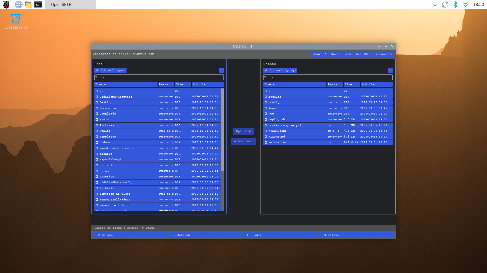
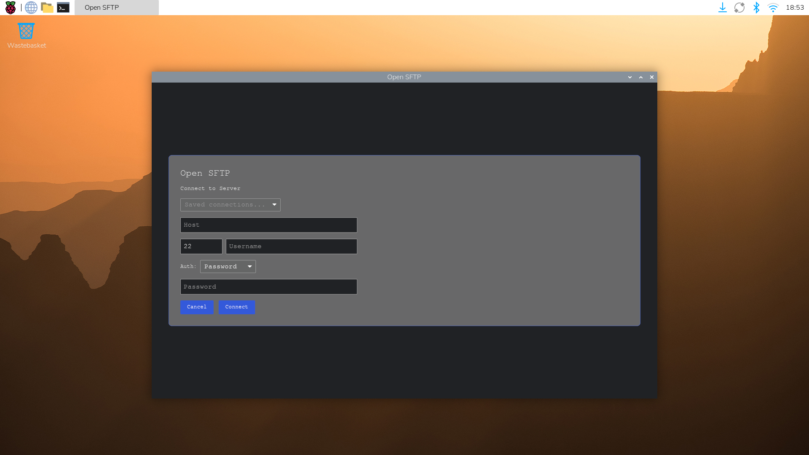

# Open SFTP

**A fast, native SFTP client written in Rust.**
Built with [Iced](https://iced.rs) for the GUI and [russh](https://github.com/warp-tech/russh) for SSH/SFTP. No Electron. No runtime overhead. Single binary, about 5 to 11 MB depending on the platform.

[](https://opensource.org/licenses/MIT)
[](https://www.rust-lang.org)



---

## Download

Pre-built binaries. No installation required.

| Platform | Download | Notes |
|----------|----------|-------|
| Windows | [opensftp-windows-x86_64.exe](https://github.com/AsyncSan/opensftp/releases/latest) | Standalone `.exe`. Not signed, so SmartScreen may warn on first run. |
| Linux (x86_64) | [opensftp-linux-x86_64](https://github.com/AsyncSan/opensftp/releases/latest) | `chmod +x opensftp-linux-x86_64 && ./opensftp-linux-x86_64` |
| macOS (Apple Silicon) | [opensftp-macos-aarch64](https://github.com/AsyncSan/opensftp/releases/latest) | `chmod +x opensftp-macos-aarch64 && ./opensftp-macos-aarch64` |
| macOS (`.app` bundle) | [OpenSFTP-0.2.1-macOS.zip](https://github.com/AsyncSan/opensftp/releases/latest) | Universal (Intel + Apple Silicon). Not notarized: allow it once under System Settings → Privacy & Security → **Open Anyway**. |
| Linux (ARM64) | [opensftp-linux-aarch64](https://github.com/AsyncSan/opensftp/releases/latest) | `chmod +x opensftp-linux-aarch64 && ./opensftp-linux-aarch64` |

On first launch, the app asks whether you want to run it **portable** (just the binary) or **install it** to your system (adds to Applications/Start Menu/Dock). You can change this anytime in Settings.

All releases: [github.com/AsyncSan/opensftp/releases](https://github.com/AsyncSan/opensftp/releases). The same files, with SHA-256 checksums, are also on [renemurrell.de/software/opensftp](https://renemurrell.de/software/opensftp/#download).

---

## Contents

1. [Download](#download)
2. [Screenshots](#screenshots)
3. [Features](#features)
4. [Build from Source](#build-from-source)
5. [Tests](#tests)
6. [Project Structure](#project-structure)
7. [License](#license)

---

## Screenshots

| File browser (connected) | Connection dialog |
|---|---|
|  |  |

---

## Features

**Dual-pane file browser:** local filesystem on the left, remote on the right. Navigate with double-click, breadcrumb path bar, or keyboard shortcuts.

**Transfers:** upload and download files and entire directories recursively. Live progress bar with byte counters. Transfer log with success/failure status.

**Authentication:** password, SSH key file, or SSH agent. Key files can be OpenSSH keys (Ed25519, ECDSA, RSA) or PEM RSA keys, with or without a passphrase; the passphrase is only kept in memory. RSA keys sign with rsa-sha2-256/512, as OpenSSH 8.8+ requires. On Windows the agent is read from the OpenSSH named pipe; Pageant is not supported.

**Host key verification:** server keys are checked against `~/.ssh/known_hosts`, including hashed entries (`HashKnownHosts yes`), several key types per host, wildcards, and `@revoked`. A changed key is refused. A host that is not in the file yet is added on first connect (trust on first use, without a prompt for now).

**Connection profiles:** save, load, and manage server connections. Favorites shown as bookmarks bar for quick connect. Profiles are stored as plain JSON in your config directory — **saved passwords are not encrypted**. Prefer SSH keys or the SSH agent. See [SECURITY.md](SECURITY.md).

**Remote operations:** create directories, rename files, delete files and folders, change permissions (chmod). Right-click context menu for quick access.

**Embedded SSH terminal:** run commands on the remote server without leaving the app. Toggle it with F4 or Ctrl+`. Each command runs on its own and shows its output when it finishes, so interactive programs (vim, top, sudo prompts) do not work there.

**Jump host:** connect through a bastion/jump host via SSH channel forwarding.

**Multi-tab sessions with restore:** open several server connections in tabs. Tabs, local and remote paths, and the sort order are saved on every change and restored on the next start; connected tabs reconnect through their saved profile. A key passphrase is never saved, so such tabs wait for you to enter it.

**Drag and drop:** drop files from your file manager onto the window to upload, or pick them with the file dialog. Dragging files out of the window is not supported.

**Filter:** each pane has a filter box that narrows the list by file name.

**22 built-in themes:** Dark, Light, Nord, Dracula, Solarized, Gruvbox, Catppuccin (Latte/Frappe/Macchiato/Mocha), Tokyo Night, Kanagawa, Moonfly, Nightfly, Oxocarbon, Ferra. Switch live in Settings, persisted across sessions.

**First-run setup:** choose portable mode or install to system (desktop shortcut, app menu). Changeable in Settings.

**Keyboard driven:** F2 rename, F4 or Ctrl+` terminal, F5 copy to the other pane, F6 move, F7 new directory, F8 or Delete delete, Tab switch pane, Enter open, Backspace up, Ctrl+A select all, Ctrl+I invert selection, Ctrl+H hidden files, Ctrl+T new tab, Ctrl+W close tab, Ctrl+Tab / Ctrl+1–9 switch tabs. Multi-select with Ctrl+Click, Shift+Click, and Space.

**Small binary:** the release build (LTO, stripped) is a single executable of about 5 MB on macOS (Apple Silicon), 8 MB on Windows, and 11 MB on Linux. Nothing to install on Windows and macOS; on Linux it uses the usual desktop libraries such as fontconfig and xkbcommon.

### Not supported (yet)

To be clear about what this does *not* do today: no FTP or FTPS (SFTP only), no parallel/multi-threaded transfers or bandwidth limiting (transfers run one at a time), no OS keychain integration, no cloud storage backends (S3, GCS), no search on the server, no interactive terminal, no dragging files out of the window, and no automatic update checks.

---

## Build from Source

Requires Rust 1.88+ and a working C linker.

```bash
git clone https://github.com/AsyncSan/opensftp.git
cd opensftp
cargo run
```

### Release Build

```bash
./build-release.sh
```

This builds optimized binaries for your current platform:
- **macOS:** `.app` bundle as `.zip` (Universal Binary: Intel + Apple Silicon)
- **Linux:** `.tar.gz` with standalone binary
- **Windows:** `.exe`

Output goes to `dist/`.

---

## Tests

```bash
cargo test
```

About 290 tests covering core modules: connection profiles, known hosts, SFTP operations, transfer engine, theme persistence, settings, session restore, desktop integration, and UI. Tests use a private temp directory and never touch your real settings, profiles, or `~/.ssh/known_hosts`.

End-to-end tests against a real SSH server are ignored by default. See the comment above `mod it` in `src/core/sftp.rs` for the setup, then run:

```bash
OPENSFTP_IT_DIR=/path/to/test-keys OPENSFTP_IT_PORT=2299 cargo test -- --ignored it_
```

---

## Project Structure

```
src/
├── main.rs                      Entry point, Iced application setup
├── core/
│   ├── connection.rs            Connection profiles (save/load/favorites)
│   ├── desktop_integration.rs   System install/uninstall (Linux/macOS/Windows)
│   ├── known_hosts.rs           SSH known_hosts parsing and verification
│   ├── sftp.rs                  russh SFTP wrapper, async file operations
│   └── transfer.rs              Upload/download engine with progress
├── theme/
│   └── mod.rs                   22 themes, settings persistence, install mode
└── ui/
    ├── app.rs                   Main state, messages, update/view, dialogs
    ├── connect_dialog.rs        Connection form (host, port, auth method)
    ├── file_panel.rs            File list widget with sorting and selection
    ├── session_store.rs         Saved tabs, paths and sort order (session.json)
    └── helpers.rs               Formatting utilities (size, permissions, timestamps)
```

---

## License

MIT. See [LICENSE](LICENSE).
